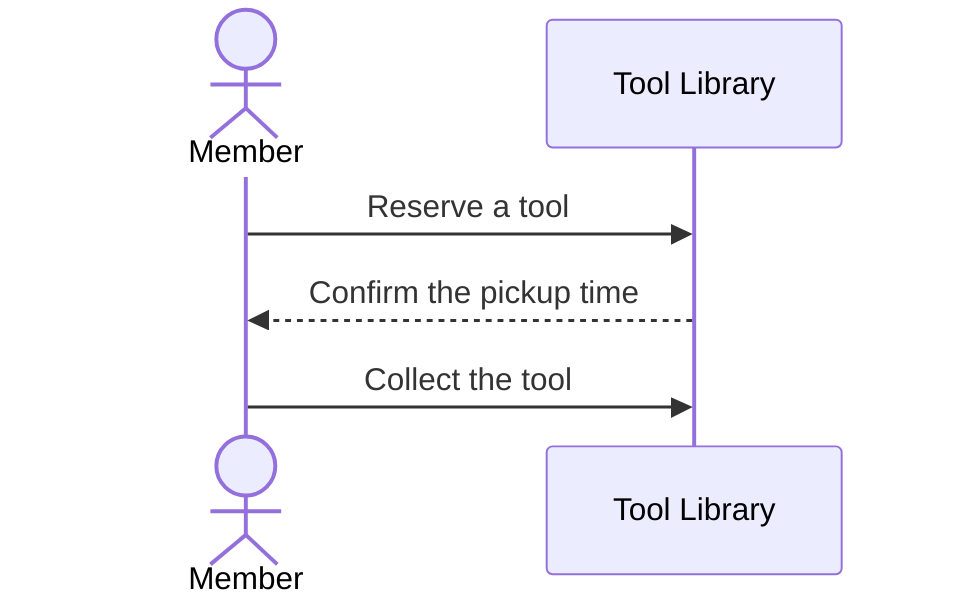

# Atlas bundle

`.workspace/` is an Open Knowledge Format (OKF) v0.2 bundle. Each `.md` file is a node, except `index.md` and `log.md`.

[nodes.json](nodes.json) lists each node type, its path, its extra keys, and its diagram. `scripts/atlas.mjs check` enforces that table. Read the table before you write a node.

Do not edit `index.md`. `okf index` writes it. Add to `log.md` with `scripts/atlas.mjs log`.

## Frontmatter

```yaml
---
type: journey
title: Borrow a tool
description: A member reserves a tool and collects it at the desk.
status: draft
realization: planned
generated: { by: atlas/0.1.0, at: 2026-10-04T09:00:00Z }
---
```

- `description` is one sentence. `okf index` copies it into `index.md`, and an agent uses it to decide whether to open the node.
- `status`: write `draft`. A person changes it to `stable` after review and adds `verified: { by: human:<id>, at: <time> }`. Do not write `verified` for a person.
- `realization` applies to the types that `nodes.json` marks. `planned` describes the target, and the code must match it. `built` describes the code, and the code is right when the two differ.
- `generated.by` is `atlas/<version>` for a node that an agent wrote. Take the version from an existing node. Set `generated.at` to the time of each content change.
- `sources` is required on a `built` node that comes from code. Each entry has a `resource`. Use a permalink that contains the commit SHA.

## Body

| Type | Body |
| --- | --- |
| `vision` | The people the system serves, their problem, the outcome, and what is out of scope. |
| `glossary` | The format of the upstream `domain-modeling` skill: `**Term**:`, a definition, then `_Avoid_:`. No implementation detail. |
| `context-map` | The bounded contexts and how they relate. Write it only when the system has more than one context. |
| `capability` | One thing the business can do, the people involved, and links to the journeys that deliver it. |
| `journey` | The trigger, the people and systems, the steps, and the outcome. Use glossary terms. Do not use names from code. |
| `system-context` | The system, its people, and its external systems. One diagram and a table of relationships. |
| `container-view` | The containers and their relationships. One diagram and a table of relationships. |
| `container` | Its responsibility, its technology if decided, and the repository that holds it. `kind` is `service`, `frontend`, `worker`, `datastore`, or `library`. |
| `decision` | The format of the upstream `domain-modeling` skill for an ADR. The file name is `NNNN-<slug>.md`. |
| `repository` | `url`, `default_branch`, and links to the containers it holds. |

[code-level.md](code-level.md) gives the body of each node of one container.

Write prose in the `language` of `atlas.md`. File names, frontmatter keys, and `type` values stay in English. Use each glossary term exactly as the glossary defines it.

## Links

Link nodes with relative paths, for example `[Borrow a tool](../journeys/borrow-a-tool.md)`. `okf` does not follow a link that starts with `/`.

Link in both directions where the table above asks for links. A capability links to its journeys. A container links to its repository.

## Diagrams

Use Mermaid in a `mermaid` code fence.

- A journey has one `sequenceDiagram`. Add a `flowchart` only when a business rule branches, for example a validation or an approval.
- `system-context` and `container-view` use `flowchart`. Label each arrow with the purpose of the call.
- Do not draw a diagram that repeats a table.


