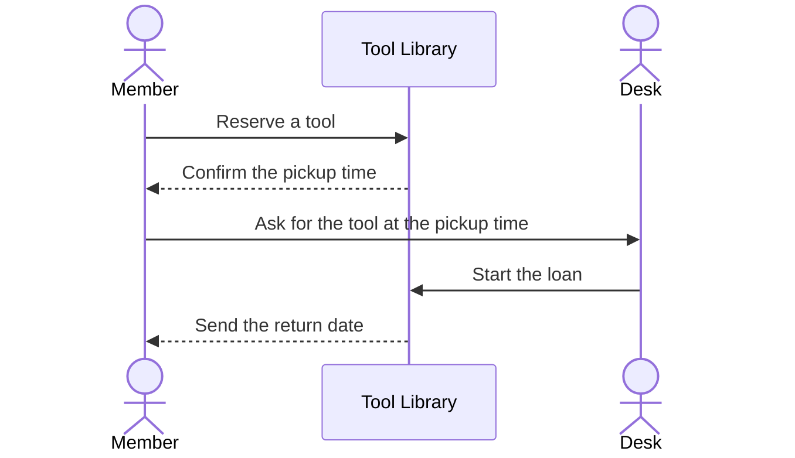
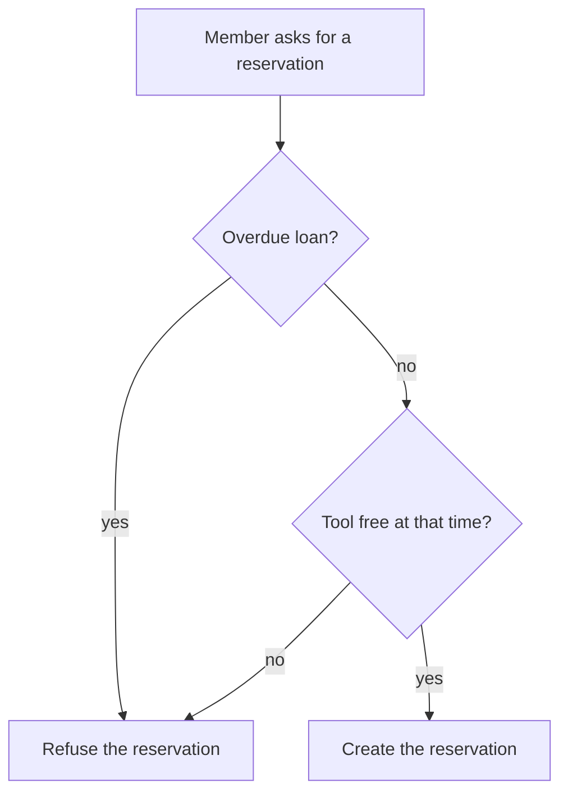

# Borrow a tool

This journey delivers the capability [Lend tools](../capabilities/lend-tools.md).

The trigger is a member who needs a tool. The outcome is a loan.

## Rules

A member can hold one reservation for each tool. The library refuses a reservation when the member has an overdue loan.

