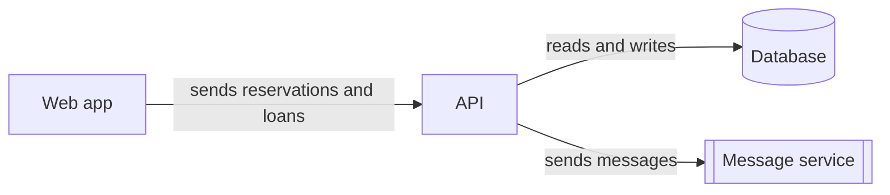

# Containers

| From | To | Purpose |
| --- | --- | --- |
| Web app | [API](containers/api/container.md) | Reserve a tool, start a loan, end a loan |
| API | Database | Store members, tools, reservations, and loans |
| API | Message service | Send the pickup time and the return date |
