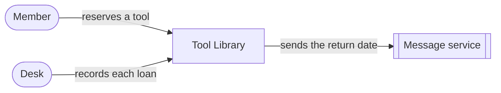

# System context

| From | To | Purpose |
| --- | --- | --- |
| Member | Tool Library | Reserve a tool |
| Desk | Tool Library | Start and end a loan |
| Tool Library | Message service | Send the pickup time and the return date |

The message service is an external system.
